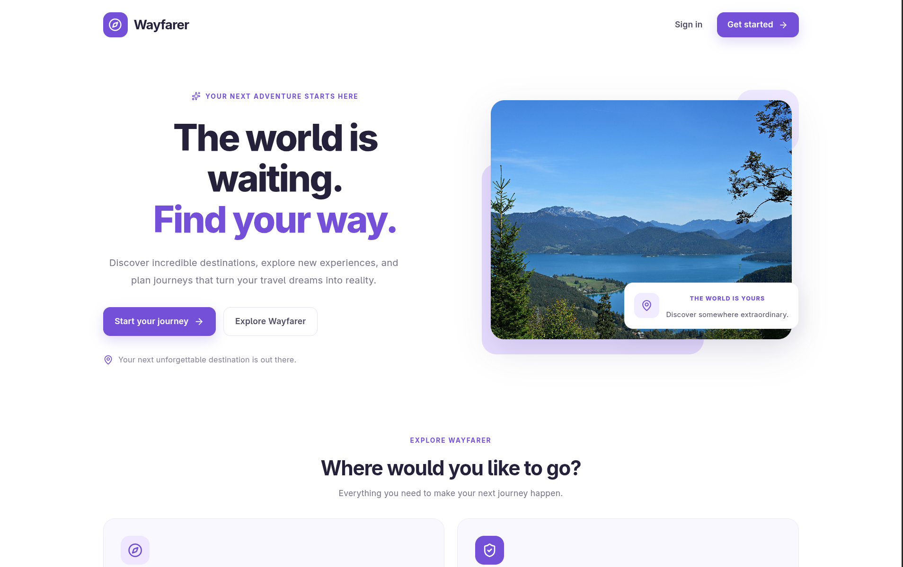
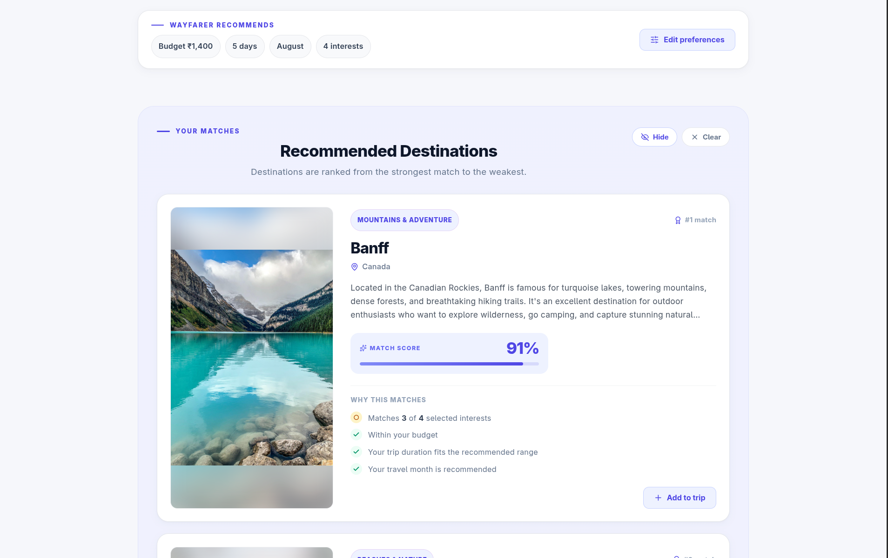
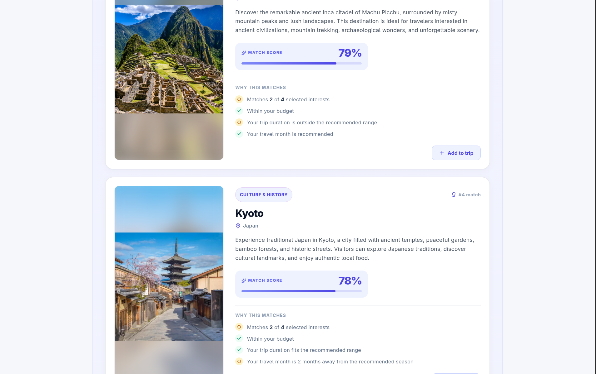

<div align="center">

# 🧭 Wayfarer

**Find where to go next. Browse destinations, get ranked recommendations for your interests, budget, and dates, and shape a journey.**


</div>

---

## About

Wayfarer is a full-stack, Dockerized trip planner that brings destination browsing, personalized recommendations, and journey planning into one place. Tell it what you enjoy, what you can spend, how long you have, and when you're travelling, and it ranks the destinations that fit best.

It's a mini project built to demonstrate full-stack development with React, FastAPI, PostgreSQL, and Docker.

## Screenshots

### Landing Page



### Destination Explorer


### Trip Recommendations



### Recommendation Results



## Features

- 🌍 **Destination discovery**: browse destinations and open detailed pages for each one.
- ✨ **Smart recommendations**: destinations ranked by your interests, budget, trip length, and travel month, with a breakdown of why each one scored the way it did.
- 🧳 **Journey view**: explore recommended destinations and see them laid out with their durations.
- 🔐 **Accounts**: register and log in, with passwords hashed using bcrypt.
- 🛠️ **Admin destination management**: admins can manage the destination catalog.
- 🗄️ **Automatic migrations**: Alembic applies schema changes on startup.
- 🐳 **One-command setup**: the whole stack runs through Docker Compose.

## How Recommendations Work

Wayfarer ranks destinations with a transparent, weighted scoring system that runs in the backend. There's no external recommendation API and no AI model involved, so every result can be explained.

Tell Wayfarer any combination of **interests**, **budget**, **trip length**, and **travel month**. Each destination is scored from 0 to 1 against every criterion you provide, then the scores are combined into a single ranking.

### Scoring criteria

| Criterion | Weight | How it's scored |
|---|:---:|---|
| Interests | 35% | The share of your selected interests that the destination covers. |
| Budget | 30% | A full score if the destination's estimated cost fits your budget. Otherwise the score drops in proportion to how far over budget it is, reaching zero at double your budget. |
| Duration | 20% | A full score if your trip length falls within the destination's recommended range. Shorter or longer trips are scaled down proportionally. |
| Season | 15% | Based on how close your travel month is to the destination's suitable months. Months wrap around the calendar, so December is one month away from January. |

### Combining the scores

- **Only the criteria you provide count.** Skip the budget, for example, and the remaining weights are rescaled so the final score is still a fair average out of 1.
- **Results are sorted by final score**, highest first. Ties are broken by the individual criterion scores in the order interests, budget, duration, season, and then by destination ID, so the ordering is always deterministic.
- **Every result explains itself.** Each recommendation comes back with a breakdown: how many of your interests matched, whether the destination is within budget, whether your trip length is in range, and how many months away your travel month is from the best season.

From there, take the top picks into the journey view, where each destination is shown with its recommended duration.

## Tech Stack

| Layer | Technology |
|---|---|
| Frontend | React, Vite |
| Backend | Python, FastAPI |
| Database | PostgreSQL |
| ORM | SQLAlchemy |
| Migrations | Alembic |
| Containerization | Docker, Docker Compose |

## Getting Started

### Prerequisites

- [Git](https://git-scm.com/)
- [Docker](https://docs.docker.com/get-docker/) with [Docker Compose](https://docs.docker.com/compose/install/) (`docker compose`)

Python, Node.js, and PostgreSQL don't need to be installed. Docker handles them.

### Run

```bash
git clone https://github.com/Geoxin3/wayfarer.git
cd wayfarer
docker compose up --build
```

Services start in order: PostgreSQL, then Alembic migrations, then the FastAPI backend, then the React frontend.

| Service | URL |
|---|---|
| Frontend | http://localhost:5173 |
| Backend API | http://localhost:8000 |
| API docs | http://localhost:8000/docs |
| PostgreSQL | `localhost:5432` |

### Stop

```bash
docker compose down
```

Data lives in the `postgres-data` Docker volume, so it survives restarts. To stop **and delete the database**:

```bash
docker compose down -v
```

> [!WARNING]
> `-v` permanently deletes the PostgreSQL volume. Use it only when you want a clean slate.

## Configuration

There's no `.env` file to set up. Ports and database settings are defined in `docker-compose.yml`. The database is named `wayfarer` and uses the development credentials `postgres` / `postgres`.

## API

Interactive FastAPI documentation is available at **http://localhost:8000/docs** once the app is running. It's always up to date, so it's the best reference for available endpoints.

## License

Distributed under the [MIT License](LICENSE).